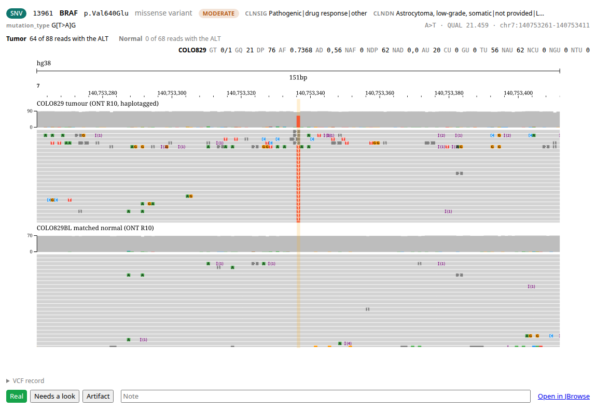

# variant-review-portal

Turn the images `jb2export batch` renders from a VCF into a **static review
portal**: one card per record, with the sample's and its control's reads in one
image, the record's VCF fields, an answer to one question per card, and a link
that opens the same loci live in JBrowse. A reviewer works through the queue by
keyboard and exports the answers as TSV.

| Scenario                                             | Hosted portal                                                                                                                  | Guide                                   |
| ---------------------------------------------------- | ------------------------------------------------------------------------------------------------------------------------------ | --------------------------------------- |
| Somatic structural variants, tumor vs normal         | [COLO829](https://jbrowse.org/demos/colo829_review/) on ONT, [HG008-T](https://jbrowse.org/demos/hg008_review/) on PacBio HiFi | [What a card holds](docs/cards.md)      |
| Somatic small variants, tumor vs normal              | [COLO829 coding variants](https://jbrowse.org/demos/colo829_snv_review/) on ONT                                                | [What a card holds](docs/cards.md)      |
| A trio's de novo candidates and Mendelian violations | [1000 Genomes KHV trio](https://jbrowse.org/demos/khv_trio_review/), chr1:190-200 Mb on 30x Illumina                           | [Reviewing a trio](docs/trio-review.md) |

## Install

```bash
git clone https://github.com/cmdcolin/variant-review-portal
cd variant-review-portal
pnpm install
npm link                     # variant-review-portal, -slice and -trio-sites
npm i -g @jbrowse/img@next   # jb2export
```

## Quick start

```bash
jb2export batch --sites calls.vcf.gz --config config.json --assembly hg38 \
  --track tumor_reads unit=chain --track normal_reads unit=chain \
  --outDir reads --manifest

variant-review-portal --vcf calls.vcf.gz --images tumor,normal=reads \
  --support TUMOR:AD,NORMAL:AD --out portal

npx serve portal
```

`--images` names the tracks in each image, the sample's first. `--support` names
the FORMAT keys the caller counts supporting reads under, in the same order, and
the portal groups the queue by them. The same commands build a portal from a VCF
of SNVs and indels.

Click a picture to open its card in the hosted portal.

<table>
<tr><td width="50%"><a href="https://jbrowse.org/demos/colo829_review/#card=366"></a><br>A 12 kb deletion through PTEN</td><td width="50%"><a href="https://jbrowse.org/demos/colo829_review/#card=343"></a><br>A chr7 to chr15 translocation</td></tr>
<tr><td width="50%"><a href="https://jbrowse.org/demos/colo829_snv_review/#card=219"></a><br>BRAF V600E with its ClinVar significance</td><td width="50%"><a href="https://jbrowse.org/demos/khv_trio_review/#card=66"></a><br>A de novo candidate in a trio</td></tr>
</table>

## Documentation

- [Rendering and building](docs/rendering.md): the `jb2export` runs, the
  zoomed-out panel, copy number, links into JBrowse
- [What a card holds](docs/cards.md): each kind of SV, read counts, genes,
  facets, events
- [Reviewing](docs/reviewing.md): keys, the table, runs of cards, your own
  question, export and import
- [Reviewing a trio](docs/trio-review.md): `variant-review-trio-sites` and
  `--pedigree`
- [Carrying the reads](docs/carrying-the-reads.md): `variant-review-slice`, for
  links that open sliced reads

[DEVELOPMENT.md](DEVELOPMENT.md) covers tests and rebuilding the gallery.

## See also

- [gene-review-portal](https://github.com/cmdcolin/gene-review-portal), the same
  review page for gene predictions
- [Static image export](https://jbrowse.org/jb2/docs/jbrowse-img/), the
  `jb2export` that draws the cards
- JBrowse's
  [SV callset review](https://jbrowse.org/jb2/docs/tutorials/sv_callset_review/)
  and
  [complex rearrangements](https://jbrowse.org/jb2/docs/tutorials/cancer_sv/)
  tutorials

## License

Apache-2.0.
