# variant-review-portal

Turn the images `jb2export batch` renders from a VCF into a **static review
portal**: one card per record, the sample and its control in one image, what the
VCF says about the call, a verdict, and a link that opens the same loci live in
JBrowse. It handles structural variants and small variants alike, and a trio's
de novo candidates and Mendelian violations with the child's and both parents'
reads.

A caller returns hundreds of variants and a VCF says nothing about which are
real. The reads do, and a picture of them per call is a queue a person can
finish.

```bash
jb2export batch --sites calls.vcf.gz --config config.json --assembly hg38 \
  --track tumor_reads --track normal_reads --outDir reads --manifest

variant-review-portal --vcf calls.vcf.gz --images tumor,normal=reads \
  --support TUMOR:AD,NORMAL:AD --out portal

npx serve portal
```

## Install

```bash
git clone https://github.com/cmdcolin/variant-review-portal
cd variant-review-portal
pnpm install
npm link                     # variant-review-portal, -slice and -trio-sites
npm i -g @jbrowse/img@next   # jb2export
```

## Gallery

Four hosted portals:
[COLO829 somatic SVs](https://jbrowse.org/demos/colo829_review/) and
[COLO829 coding variants](https://jbrowse.org/demos/colo829_snv_review/) on ONT
reads, [HG008-T somatic SVs](https://jbrowse.org/demos/hg008_review/) on PacBio
HiFi, with reads carried in the portal itself, and the
[1000 Genomes KHV trio](https://jbrowse.org/demos/khv_trio_review/) over
chr1:190-200 Mb on 30x Illumina. Each picture opens its card live; the last two
rows are the trio's.

<table>
<tr><td width="50%"><a href="https://jbrowse.org/demos/hg008_review/#card=event%3Acluster_12">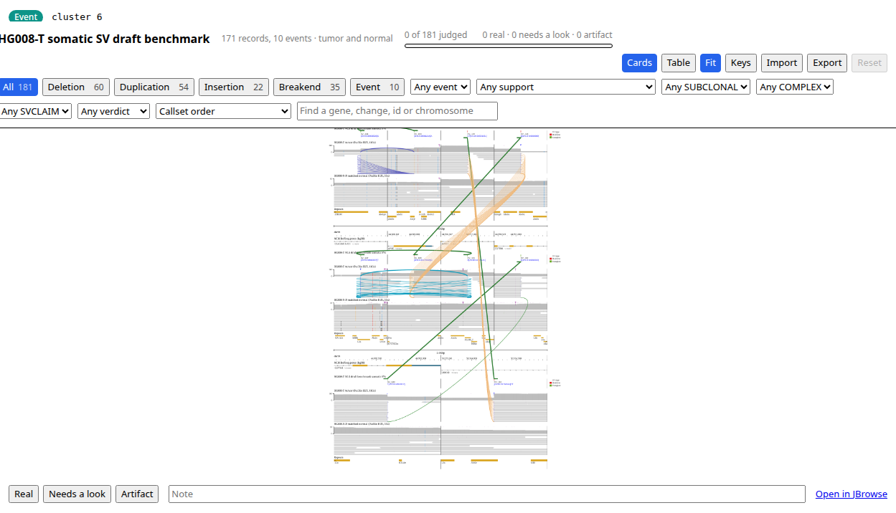</a><br>A duplication and an inversion, interleaved on chr17</td><td width="50%"><a href="https://jbrowse.org/demos/hg008_review/#card=115">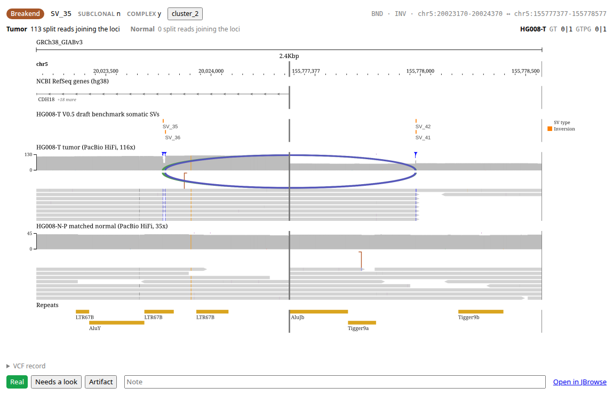</a><br>An inversion across 136 Mb of chr5</td></tr>
<tr><td width="50%"><a href="https://jbrowse.org/demos/colo829_review/#card=366">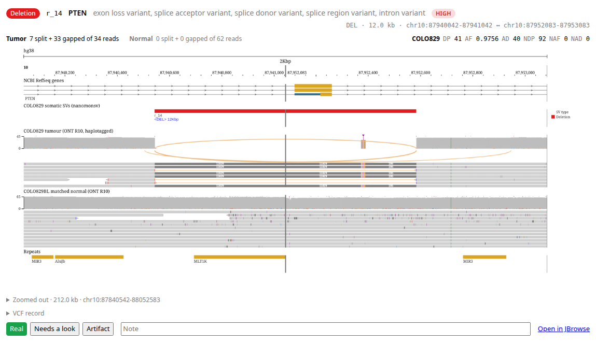</a><br>A 12 kb deletion through PTEN</td><td width="50%"><a href="https://jbrowse.org/demos/hg008_review/#card=125">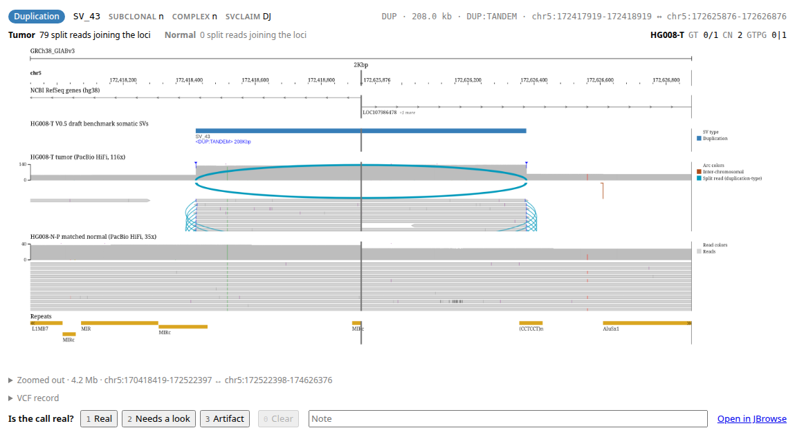</a><br>A 208 kb tandem duplication</td></tr>
<tr><td width="50%"><a href="https://jbrowse.org/demos/colo829_review/#card=297">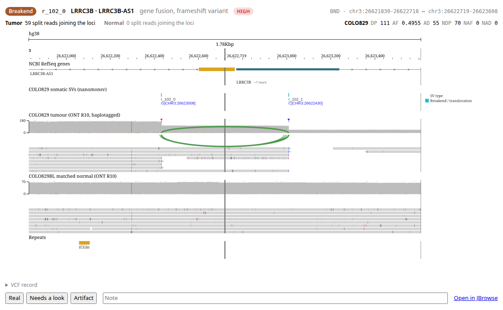</a><br>An LRRC3B gene fusion</td><td width="50%"><a href="https://jbrowse.org/demos/colo829_snv_review/#card=219"></a><br>BRAF V600E, called and annotated</td></tr>
<tr><td width="50%"><a href="https://jbrowse.org/demos/colo829_review/#card=343">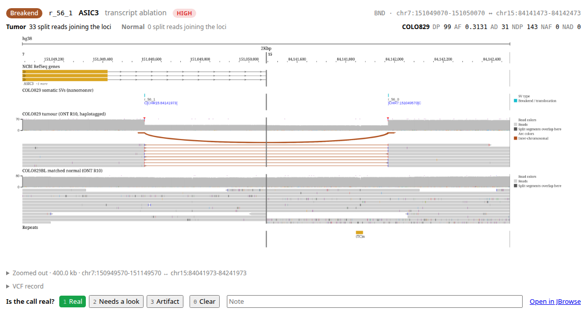</a><br>A chr7 to chr15 translocation</td><td width="50%"><a href="https://jbrowse.org/demos/colo829_review/#sort=format%3AAF&view=table">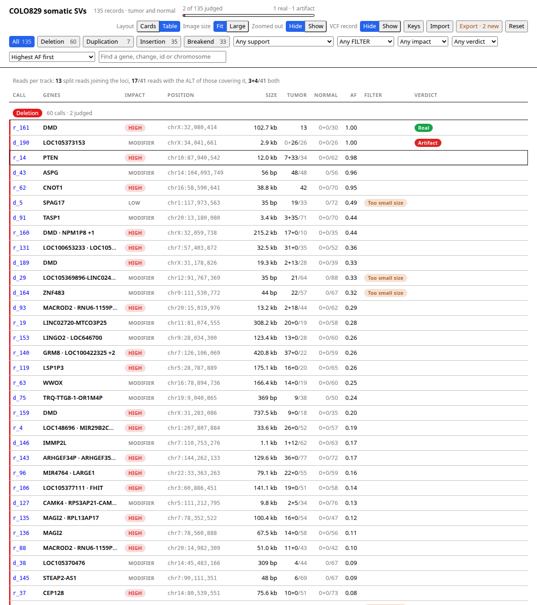</a><br>The callset as a table</td></tr>
<tr><td width="50%"><a href="https://jbrowse.org/demos/khv_trio_review/#card=66">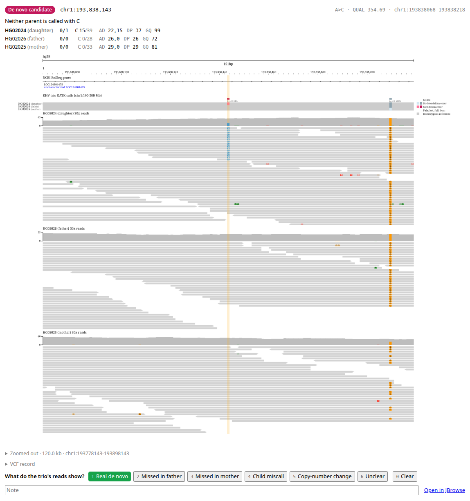</a><br>A de novo candidate only the child's reads carry</td><td width="50%"><a href="https://jbrowse.org/demos/khv_trio_review/#card=21">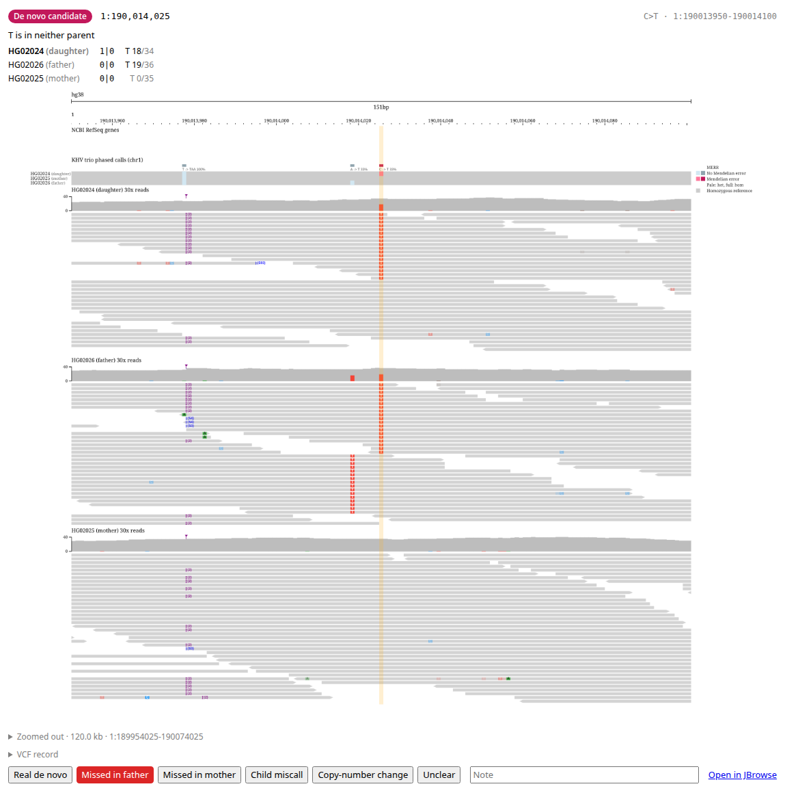</a><br>A het the father's call missed</td></tr>
<tr><td width="50%"><a href="https://jbrowse.org/demos/khv_trio_review/#card=100">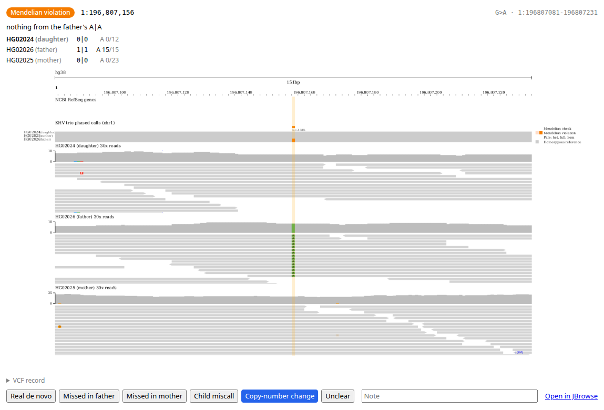</a><br>A Mendelian violation from the CFHR1 deletion</td><td width="50%"><a href="https://jbrowse.org/demos/khv_trio_review/#support=sample&view=table">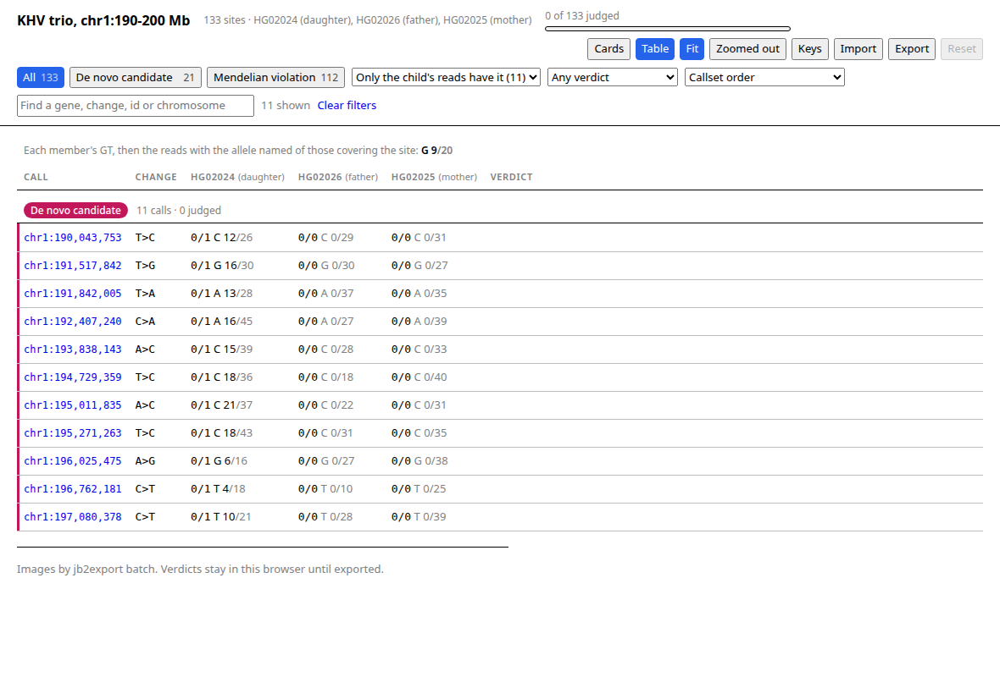</a><br>The trio's table, filtered by read support</td></tr>
</table>

## Documentation

- [Rendering and building](docs/rendering.md): the `jb2export` run, versions,
  links into JBrowse, what comes out
- [What a card holds](docs/cards.md): supporting reads, caller counts, genes,
  facets, events
- [Reviewing](docs/reviewing.md): keys, the table, export and import
- [Carrying the reads](docs/carrying-the-reads.md): `variant-review-slice`, for
  links that open sliced reads
- [Reviewing a trio](docs/trio-review.md): `--pedigree` and
  `variant-review-trio-sites`, a queue of the sites the Mendelian check flags

[DEVELOPMENT.md](DEVELOPMENT.md) covers tests and rebuilding the gallery.

## See also

- [gene-review-portal](https://github.com/cmdcolin/gene-review-portal), the same
  review page for gene predictions
- [Reviewing a whole SV callset](https://jbrowse.org/jb2/docs/tutorials/sv_callset_review/)
  and
  [Complex rearrangements](https://jbrowse.org/jb2/docs/tutorials/cancer_sv/),
  JBrowse tutorials
- [Static image export](https://jbrowse.org/jb2/docs/jbrowse-img/), the
  `jb2export` that draws the cards
- [SV inspector](https://jbrowse.org/jb2/docs/user_guides/sv_inspector_view/)
  and
  [alignments track](https://jbrowse.org/jb2/docs/user_guides/alignments_track/)
  user guides

## License

Apache-2.0.
