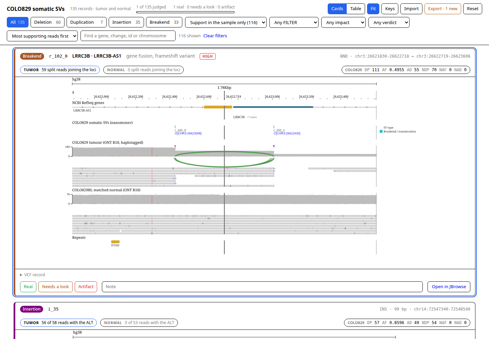
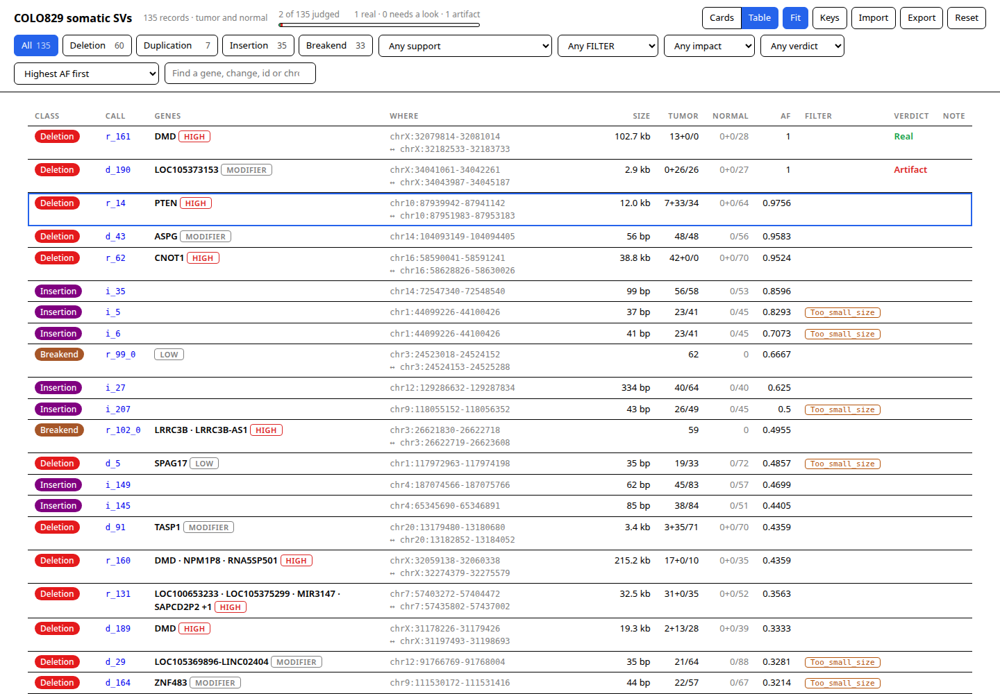
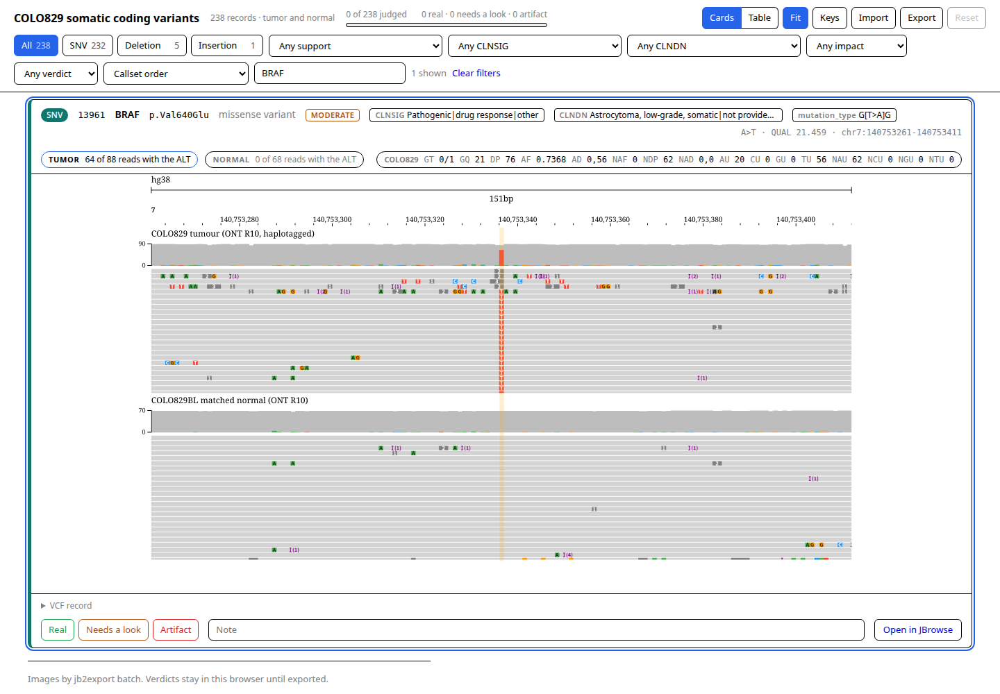

# variant-review-portal

Turn the images `jb2export batch` renders from a VCF into a **static review
portal**: one card per record, the sample and its control in one image, what the
VCF says about the call, a verdict, and a link that opens the same loci live in
JBrowse. It handles structural variants and small variants alike.

A caller returns hundreds of variants and a VCF says nothing about which are
real. The reads do, and a picture of them per call is a queue a person can
finish.

```bash
jb2export batch --sites calls.vcf.gz --config config.json --assembly hg38 \
  --track tumor_reads --track normal_reads --outDir reads --manifest

variant-review-portal --vcf calls.vcf.gz --images tumor,normal=reads \
  --support TUMOR:AD,NORMAL:AD --out portal

npx serve portal
```

## Install

```bash
git clone https://github.com/cmdcolin/variant-review-portal
cd variant-review-portal
pnpm install
npm link                     # variant-review-portal and variant-review-slice
npm i -g @jbrowse/img@next   # jb2export
```

## Gallery

[COLO829 somatic SVs](https://jbrowse.org/demos/colo829_review/), filtered to
the calls only the tumor carries: a breakend joined by 59 tumor split reads and
none in the matched normal.



The same callset as a table, ordered by the caller's allele fraction.



[COLO829 coding variants](https://jbrowse.org/demos/colo829_snv_review/): _BRAF_
V600E, written `p.Val640Glu` on the MANE transcript, with the ALT base in 64 of
88 tumor reads and none of the normal's.



[HG008-T somatic SVs](https://jbrowse.org/demos/hg008_review/) is a third hosted
portal, PacBio HiFi, with reads carried in the portal itself.

## Documentation

- [Rendering and building](docs/rendering.md): the `jb2export` run, versions,
  links into JBrowse, what comes out
- [What a card holds](docs/cards.md): supporting reads, caller counts, genes,
  facets, events
- [Reviewing](docs/reviewing.md): keys, the table, export and import
- [Carrying the reads](docs/carrying-the-reads.md): `variant-review-slice`, for
  links that open sliced reads

[DEVELOPMENT.md](DEVELOPMENT.md) covers tests and rebuilding the screenshots.

## See also

- [gene-review-portal](https://github.com/cmdcolin/gene-review-portal), the same
  review page for gene predictions
- [Reviewing a whole SV callset](https://jbrowse.org/jb2/docs/tutorials/sv_callset_review/)
  and
  [Complex rearrangements](https://jbrowse.org/jb2/docs/tutorials/cancer_sv/),
  JBrowse tutorials
- [Static image export](https://jbrowse.org/jb2/docs/jbrowse-img/), the
  `jb2export` that draws the cards
- [SV inspector](https://jbrowse.org/jb2/docs/user_guides/sv_inspector_view/)
  and
  [alignments track](https://jbrowse.org/jb2/docs/user_guides/alignments_track/)
  user guides

## License

Apache-2.0.
