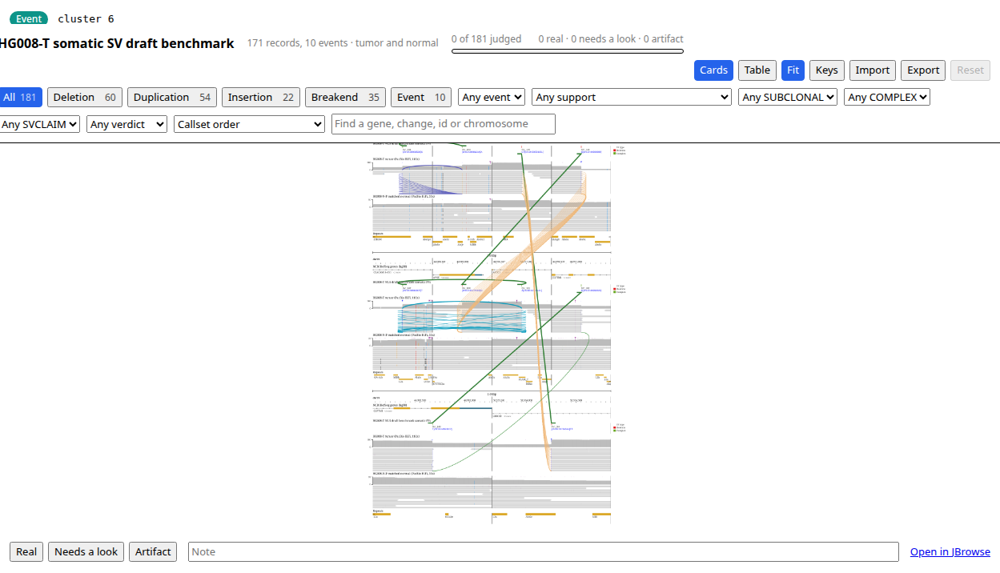
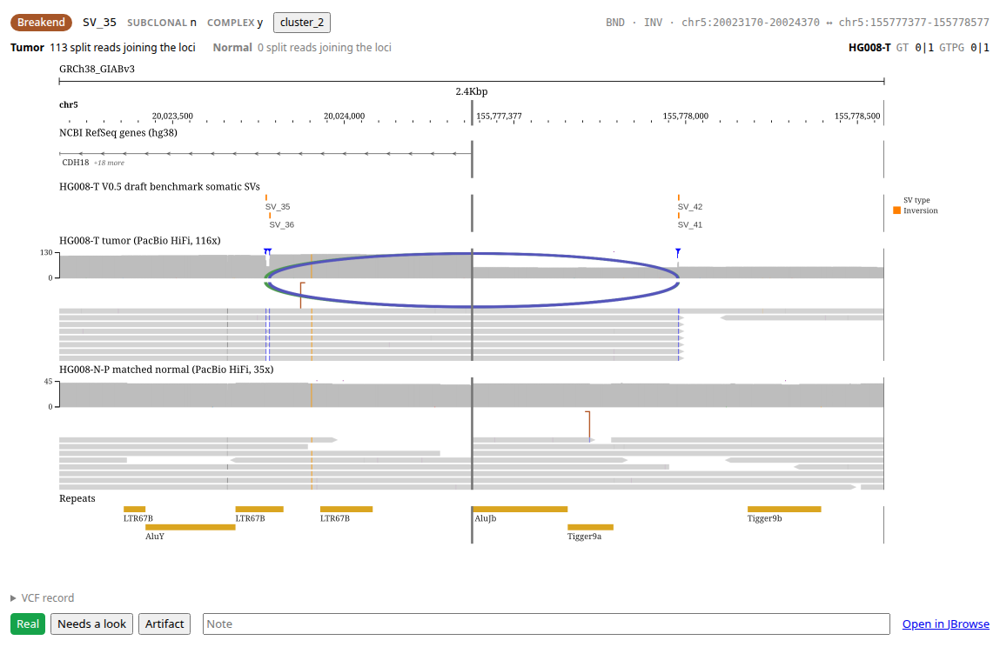
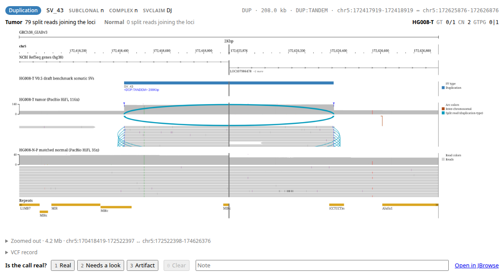
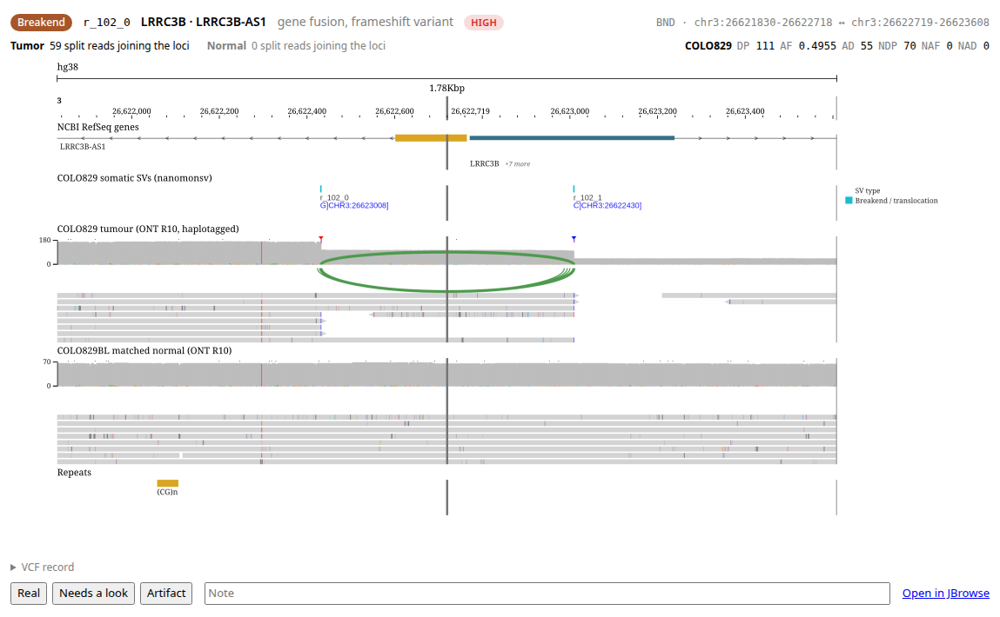

# What a card holds

## The image

`jb2export` draws a record as one linear view, with the sample's reads above its
control's and any other track of the run (genes, ClinVar, the callset, repeats)
beside them. A small variant is one window, its pileups sorted at the variant's
base. The ends of an SV, and every locus of an event, are windows side by side
in one row under an arc of the reads joining them.

| SV class           | The card shows                                                                          |
| ------------------ | --------------------------------------------------------------------------------------- |
| Deletion           | The tumor's coverage drops between the ends; split reads and reads with a gap span them |
| Tandem duplication | An arc of split reads from the end of the copy back to its start                        |
| Inversion          | An arc of split reads between the two ends                                              |
| Translocation      | Both chromosomes' windows in one row, with an arc of split reads from one to the other  |
| Complex event      | A separate card with every locus of the caller's `EVENT` in one image                   |

<table>
<tr><td width="50%"> A duplication and an inversion, interleaved on chr17</td><td width="50%"> An inversion across 136 Mb of chr5</td></tr>
<tr><td width="50%"> A 208 kb tandem duplication</td><td width="50%"> An LRRC3B gene fusion</td></tr>
</table>

The image scales to fit the window; click it, or press <kbd>f</kbd>, for full
size. A `jb2export` of 5.0.0-beta.22 or older stacks a translocation's
chromosomes as the panels of a breakpoint split view instead.

## Read counts

- **The caller's counts** group the queue, so `--support` is required. It names
  the FORMAT keys the caller counts supporting reads under, the sample's first.
  - `--support AD,NAD` reads nanomonsv's tumor and normal counts from one
    column, and `--support TUMOR:AD,NORMAL:AD` reads `AD` from two.
  - Left out, the build stops and lists the VCF's samples and numeric FORMAT
    keys.
  - The support filter splits the queue into calls with no supporting read,
    calls supported in a control too, and calls supported in the sample alone.
- **jb2export's counts** sit beside the caller's as a second opinion: the split
  reads joining the windows, and, where the ALT spells out the change, the reads
  with the ALT of those covering it (`3 split + 4 gapped of 56 reads`).
  - They can show a split read in the normal that the caller did not count.
  - They can come out lower: on COLO829, `d_163` and `d_38` count zero here,
    because their reads place the deletion a few bases right of the caller's
    position.
  - `--support jb2export` groups on these counts, for a VCF that has none.

## What the caller wrote

- **The record**: `SVTYPE`, size, `FILTER`, `QUAL` and the sample columns, and
  under **VCF record** every `INFO` key. Hover a key for the header's
  description.
- **Genes**: for a VCF annotated by SnpEff (`ANN`) or VEP (`CSQ`), the genes,
  effect and protein change (`p.Val600Glu`) of the highest-impact annotation,
  with an impact filter in the header.
- **Facets**: `--facet CLNSIG,CLNDN` prints those `INFO` keys on every card and
  adds a filter for each. `FILTER` is one already when the callset holds more
  than one value.
- **Events**: a caller's `EVENT` is a filter, and the chip on a card selects it.
  Severus's `CLUSTERID`
  [needs renaming to `EVENT`](https://jbrowse.org/jb2/docs/user_guides/sv_inspector_view/#rearrangement-events).
- **A link**, given `--jbrowse` and `--config`: see
  [Links back into JBrowse](rendering.md#links-back-into-jbrowse).
