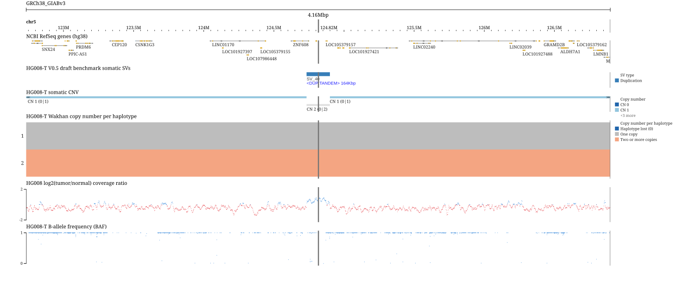

# Rendering and building

A portal is built in two steps: `jb2export batch` draws one image per record,
and `variant-review-portal` turns those images and the VCF into a page.

```bash
# every track in one run, so each record is one image; a read drawn with its
# mate and split segments in one row, and only the pairs that do not fit the
# reference as arcs
READS=(unit=chain readConnections.ordinaryPairs.show=false height:150)
jb2export batch --sites calls.vcf.gz --config config.json --assembly hg38 \
  --track genes height:50 --track calls height:50 \
  --track tumor_reads "${READS[@]}" --track normal_reads "${READS[@]}" \
  --track repeats height:50 --outDir reads --manifest

# the tracks in the images, in track order, the sample's first, and the FORMAT
# keys the caller counts their supporting reads under
variant-review-portal --vcf calls.vcf.gz \
  --images tumor,normal=reads --support TUMOR:AD,NORMAL:AD --out portal
```

`jb2export` comes from
[`@jbrowse/img`](https://www.npmjs.com/package/@jbrowse/img). Small variants
need one newer than 5.0.0-beta.13, and a live link one whose manifest has the
`spec` column.

## Reads track options

- **Height**: `height:150` cuts the pileup at 150 px. With no height,
  `jb2export batch` grows a track to 250 px, the reads with the ALT sorted to
  the top. `heightMode:grow growMaxHeight=1000` draws a 30x pileup whole, at the
  cost of taller cards.
- **`unit=chain`** is JBrowse's "View as pairs/link supplementary alignments": a
  read, its mate and its split segments share one row. A deletion's discordant
  pairs then stack as rows spanning it, not as halves on separate rows.
- **`readConnections.ordinaryPairs.show=false`** leaves out the arcs of pairs
  that fit the reference, which in a short-read pileup cover the band in grey.

## Zoomed out

`--context <dir>` takes a second run with a wide `--flank` and shows it in a
**Zoomed out** panel under each card, joined on the record's line. A small
variant inside a copy-number change or a larger SV shows there. Its tracks are
not counted, so it takes no names.

```bash
# 200 kb around each record: coverage on one axis, and the pairs and split reads
# that do not fit the reference as arcs
WIDE=(pileup.show=false coverage.alleles.show=false
  coverage.interbase.show=false maxScore=80
  readConnections.show=true readConnections.ordinaryPairs.show=false height:130)
jb2export batch --sites calls.vcf.gz --config config.json --assembly hg38 \
  --track genes height:60 --track tumor_reads "${WIDE[@]}" \
  --track normal_reads "${WIDE[@]}" --flank 100000 --outDir wide --manifest

variant-review-portal --vcf calls.vcf.gz --images tumor,normal=reads \
  --context wide --support TUMOR:AD,NORMAL:AD --out portal
```

Set `maxScore` above the deepest sample's coverage, so every sample is drawn on
one axis.

### Copy number and B-allele frequency

A context run can draw a tumor's copy-number segments, log2 depth ratio and
B-allele frequency (BAF) instead of reads. Over a few megabases they show
whether an SV sits in a gain, a loss or a run of loss of heterozygosity. They
are bigWigs and BEDs, so a card renders in seconds.
[`examples/hg008/config.json`](../examples/hg008/config.json) carries HG008-T's,
from the
[Cancer GIAB tutorial](https://jbrowse.org/jb2/docs/tutorials/cnv_cgiab/).

```bash
jb2export batch --sites hg008.vcf.gz --config examples/hg008/config.json \
  --assembly GRCh38_GIABv3 --track hg38_ncbiRefSeq_ucsc height:60 \
  --track hg008t_benchmark_sv height:40 --track hg008t_somatic_cnv height:40 \
  --track HG008_log2ratio height:90 --track HG008-T_baf height:90 \
  --flank 2000000 --outDir cn --manifest
```



### The whole genome

`--overview <png>` shows one image above the queue, in a **Genome overview**
panel, such as the same tracks over every chromosome: HG008-T's losses of whole
arms and its long runs of LOH, before the first card. It renders in about 10 s.

```bash
jb2export --config examples/hg008/config.json --assembly GRCh38_GIABv3 \
  --loc "$(printf 'chr%s ' {1..22} X)" --track hg008t_somatic_cnv height:40 \
  --track HG008_log2ratio height:90 --track HG008-T_baf height:90 \
  --width 1600 --out genome.png

variant-review-portal --vcf hg008.vcf.gz --images tumor,normal=reads \
  --context cn --overview genome.png --support jb2export --out portal
```

## Images rendered apart

Repeat `--images`, one directory per run, and a card stacks them. The first
directory's rows are the cards, and every other joins on the record's line in
the VCF.

## Links back into JBrowse

Given `--jbrowse` and `--config`, each card links to the view its image was
drawn in, from the manifest's `spec` column. A track made from a file flag such
as `--bam` is in no hosted config, so the link leaves it out.
[Carrying the reads](carrying-the-reads.md) puts the reads in the portal itself.

## What comes out

```
portal/
  index.html      the review page
  img/<tracks>/   a copy of each run's images
  config.json     with variant-review-slice: the config its links open
  reads/          with variant-review-slice: the sliced reads
```

Every path is relative to the portal's directory, so
`aws s3 sync portal/ s3://…` deploys it whole.
