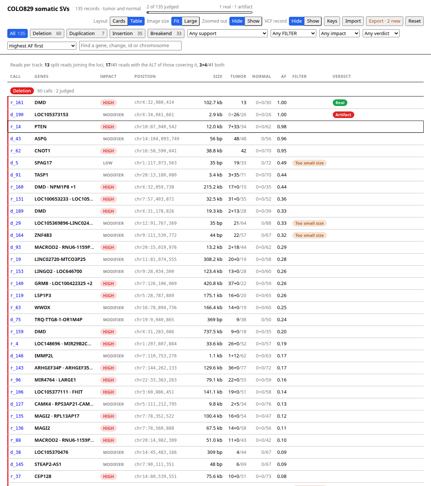

# Reviewing

Each card asks one question, **Is the call real?**, with its answers as buttons
under the images, each showing its key. A trio card asks **What do the trio's
reads show?** instead. **Clear** takes the answer back.

| Key                         | Does                                                              |
| --------------------------- | ----------------------------------------------------------------- |
| <kbd>j</kbd> <kbd>k</kbd>   | next, previous card                                               |
| <kbd>1</kbd>, <kbd>2</kbd>… | answer the card under the cursor                                  |
| <kbd>0</kbd>                | clear its answer                                                  |
| <kbd>J</kbd> <kbd>K</kbd>   | select a run of cards; <kbd>Esc</kbd> drops it                    |
| <kbd>n</kbd>                | write a note                                                      |
| <kbd>o</kbd>                | open the card in JBrowse                                          |
| <kbd>z</kbd> <kbd>Z</kbd>   | the zoomed-out view on this card, on every card, with `--context` |
| <kbd>t</kbd>                | cards or table; <kbd>Enter</kbd> opens a row's card               |
| <kbd>f</kbd>                | fit images to the window, or full size                            |
| <kbd>/</kbd>                | search                                                            |
| <kbd>?</kbd>                | show these keys                                                   |

With the verdict filter on **Unreviewed**, each card leaves the queue once
answered. The URL holds the filters, the order and the card under the cursor, so
copying it links to that card in that queue.

## The table

<kbd>t</kbd> shows the queue as a table, a section per class and a line per
card. The order menu sorts by size, by split reads, by the reads a control has,
or by any number in the caller's sample column.

[](https://jbrowse.org/demos/colo829_review/#sort=format%3AAF&view=table)

## Answering a run of cards at once

One cause, such as a deletion, can flag many neighboring sites. Shift-click a
second card or row, or press <kbd>J</kbd> or <kbd>K</kbd>, to select every card
from the cursor to there. An answer then applies to the whole selection. In the
table, sorted by position, such a run is a block of neighboring rows.

## Asking your own question

`--question question.json` replaces the question and its answers, as
[SV-plaudit](https://github.com/jbelyeu/SV-plaudit)'s `-q` and `-A` do:

```json
{
  "question": "Does the sample's evidence support the call?",
  "answers": [
    { "label": "Supports", "key": "s", "tone": "real" },
    { "label": "Does not support", "key": "d", "tone": "artifact" },
    { "label": "De novo", "key": "v", "tone": "accent" }
  ]
}
```

| Field   | Is                                                                         | Unless given           |
| ------- | -------------------------------------------------------------------------- | ---------------------- |
| `label` | the button's text; required                                                |                        |
| `value` | what the browser stores and **Export** writes in the `verdict` column      | the label              |
| `key`   | one character; the build refuses a key the page uses, such as <kbd>n</kbd> | its place, 1 up        |
| `tone`  | the pressed button's color: `real`, `unsure`, `artifact` or `accent`       | the card's class color |
| `title` | the button's tooltip                                                       |                        |

The page drops a stored answer that no button offers. To rename a label and keep
the answers already given, give the old label as its `value`.

## Saving answers

Answers and notes live in the reviewer's browser until **Export** writes them as
TSV, beside each record's line, id, coordinates, genes and read counts.
**Import** reads that TSV back, for a second reviewer or a second machine. The
button counts the cards answered or noted since the last export or import, as
`Export · 3 new`.
