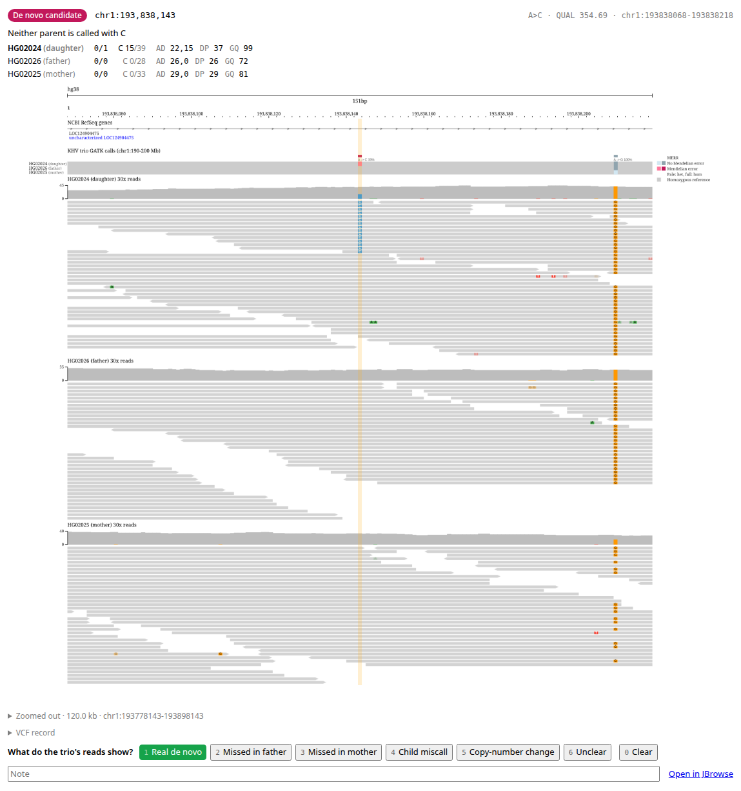
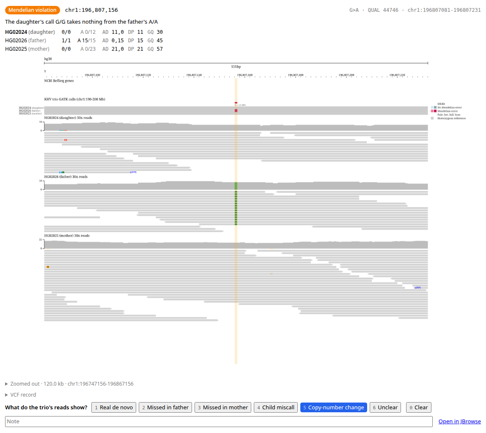

# Reviewing a trio

`variant-review-trio-sites` reads a trio VCF and its pedigree and keeps the
sites where the child's genotype cannot be made of one gamete from each parent.
A reviewer checks each site in the child's and both parents' reads, so the
portal draws all three in one picture per site.

```bash
# the sites the Mendelian check flags, de novo candidates and Mendelian
# violations, as a VCF jb2export can render
variant-review-trio-sites --vcf calls.q20.vcf.gz \
  --pedigree 20130606_g1k_3202_samples_ped_population.txt --out sites.vcf

# the calls, then the child's reads and the parents', in one image a site
jb2export batch --sites sites.vcf --config examples/khv_trio/config.json \
  --assembly hg38 --track ncbi_refseq_109_hg38_latest height:50 \
  --track khv_trio_calls height:70 \
  --track HG02024_cram heightMode:grow growMaxHeight=1000 \
  --track HG02026_cram heightMode:grow growMaxHeight=1000 \
  --track HG02025_cram heightMode:grow growMaxHeight=1000 \
  --flank 75 --outDir reads --manifest

# the same tracks 120 kb wide: each member's coverage on one 0-60 axis, and an
# arc for each pair or split read that does not fit the reference
WIDE=(pileup.show=false coverage.alleles.show=false
  coverage.interbase.show=false maxScore=60
  readConnections.show=true readConnections.ordinaryPairs.show=false height:130)
jb2export batch --sites sites.vcf --config examples/khv_trio/config.json \
  --assembly hg38 --track ncbi_refseq_109_hg38_latest height:60 \
  --track khv_trio_calls height:60 --track HG02024_cram "${WIDE[@]}" \
  --track HG02026_cram "${WIDE[@]}" --track HG02025_cram "${WIDE[@]}" \
  --flank 60000 --outDir wide --manifest

# name each alignments track by its sample, in track order
variant-review-portal --vcf sites.vcf \
  --pedigree 20130606_g1k_3202_samples_ped_population.txt \
  --images HG02024,HG02026,HG02025=reads --context wide --out portal
```

[`examples/khv_trio/config.json`](../examples/khv_trio/config.json) holds the
trio's calls (made as in [The calls](#the-calls)), colored by the `INFO/MERR` of
`bcftools +mendelian2 -m a`, and each member's 30x CRAM, named by sample and
relationship. Those labels need a `jb2export` newer than 5.0.0-beta.22.

## The calls

The calls are the trio's columns of the 1000 Genomes GATK joint call of 3202
samples over chr1:190-200 Mb, with each member's `AD`, `DP` and `GQ`, so a card
shows how much evidence each call rests on. The project's phased panel carries
`GT` alone, and its phasing rewrote some genotypes: at chr1:190,014,025 the
joint call has the father `0/1` on 17 REF and 19 ALT reads at GQ 99, and the
panel has him `0|0`. Of the 173 sites the panel flags over these 10 Mb, the
joint call flags 82.

```bash
# the trio's columns, AD declared Number=R so it trims with the alleles, the
# * allele of a base an overlapping deletion removes left missing, and MERR
JOINT=https://1000genomes.s3.amazonaws.com/1000G_2504_high_coverage/working/20201028_3202_raw_GT_with_annot/20201028_CCDG_14151_B01_GRM_WGS_2020-08-05_chr1.recalibrated_variants.vcf.gz
bcftools view -r chr1:190000000-200000000 -s HG02024,HG02026,HG02025 \
  -Oz -o trio.vcf.gz "$JOINT"
bcftools view -h trio.vcf.gz |
  sed 's/^##FORMAT=<ID=AD,Number=\./##FORMAT=<ID=AD,Number=R/' > ad.hdr
bcftools reheader -h ad.hdr trio.vcf.gz |
  bcftools norm -m -any --multi-overlaps . -Ou |
  bcftools view -e 'ALT="*"' -Ou | bcftools norm -m +any -Ou |
  bcftools view -a -c 1 -Ou |
  bcftools annotate -x '^INFO/AC,INFO/AN,INFO/DP,INFO/QD,INFO/FS,INFO/MQ,^FORMAT/GT,FORMAT/AD,FORMAT/DP,FORMAT/GQ' -Ou |
  bcftools +mendelian2 -p HG02024,HG02026,HG02025 --rules GRCh38 -m a \
    -Oz -o HG02024_VN049_KHVTrio.chr1_190_200.gatk.merr.vcf.gz

# the queue's calls: VQSR PASS, and GQ 20 in each member
bcftools view -f PASS -i 'MIN(FMT/GQ)>=20' \
  HG02024_VN049_KHVTrio.chr1_190_200.gatk.merr.vcf.gz -Oz -o calls.q20.vcf.gz
```

The joint call is 140 GB for chr1; `bcftools view -r` reads the 10 Mb from the
S3 mirror in about five minutes, where the EBI FTP is many times slower. The
calls track shows every call; the GQ filter only shortens the queue.

Each reads track grows to 1000 px, so every read of a 30x member is in the
picture ([Reads track options](rendering.md#reads-track-options)).

The wide run is the card's [Zoomed out](rendering.md#zoomed-out) panel. A site
inside a deletion or duplication is one of a run of errors there, and a member's
coverage steps down or up across it, which the 150 bp picture cannot show. It
takes about 10 s a site for the three CRAMs.

- **One axis**: `maxScore=60` draws the three members on one scale, so a member
  at half the others' depth looks it.
- **No allele colors**: reads from a paralog pile mismatches on every base and
  hide a dip under them.
- **Arcs for the pairs that do not fit**: a deletion with clean breakpoints
  draws red long-insert arcs across it in the members who carry it, eight in the
  daughter at the LCE3B/LCE3C deletion, chr1:152,583,067-152,615,300.
- **Coverage where arcs fail**: a deletion between segmental duplications, as at
  CFHR1, draws no arcs, since no read maps uniquely at its breakpoints.


## Input

- **`--pedigree`** is the file JBrowse's `pedigreeLocation` reads.
  - A PLINK `.fam` or `.ped` with no header (FID, IID, PAT, MAT, SEX, PHENO), or
    a table whose header names `SampleID` or `IID`, `FatherID` or `PAT`,
    `MotherID` or `MAT` and `Sex`, as 1000 Genomes'
    `20130606_g1k_3202_samples_ped_population.txt` does. The first row decides
    which, never the extension.
  - A line holding a tab is split on tabs, so an empty cell keeps its column.
  - A parent or sex of `0`, `-9`, `NA`, `unknown` or an empty cell is missing.
    Sex `1` is male, `2` female and anything else `other`.
- **The trio** is the child among the VCF's samples whose father or mother is
  among them too. A VCF holding more than one takes `--child` to pick it. A
  child with one parent in the VCF is a duo, and one whose father and mother are
  the same sample is a selfed line.
- **`--transmission`** is a JSON list in the format of the assembly's
  `transmission` slot, `{ "refName", "sex", "from" }`, for sex chromosomes,
  organelles and haplodiploid males. `refName` matches the VCF's `CHROM`.
  Without it, every contig follows the autosomal rule, so a hemizygous male X
  call counts as a violation.
- **The alignments tracks** are one `jb2export batch` run, the child's track
  first. `--images` names each by its VCF sample, so the portal can match each
  read count to its sample. A track left out (a parent with no reads) leaves
  that member's read column empty.

## The classifier

Both commands run `lib/classifyTrio.mjs`, which reads the ploidy from each
genotype and ignores phase. It splits a flagged site into a **de novo
candidate**, with an allele no parent is called with, or a **Mendelian
violation**. Both are about the calls: most flagged sites are a caller's error,
and the reviewer settles each one from the reads.

- A duo whose known parent cannot settle a site is no call.
- `either`, polyploid and aneuploid splits never report a violation.
- On the KHV trio over chr1:190-200 Mb, it flags the same 133 sites as the
  `INFO/MERR` of `bcftools +mendelian2 -m a`, which JBrowse's trio tutorial
  colors the calls by.

## The queue

`variant-review-trio-sites` keeps the records whose class is in `--classes`, in
the VCF's order and with its header. The default is
`deNovoCandidate,mendelianViolation`; `consistent` and `unsettled` (a no-call
leaves the check open) are the others. The portal shows de novo candidates
first, then Mendelian violations, each in position order.

## A card

- **One image**: the calls track, then the child's, father's and mother's reads
  at the site, each track labeled with the sample and relationship its config
  names (`HG02024 (daughter)`).
- **The trio's calls**: each member's sample, relationship, `GT` and whatever
  else its `FORMAT` holds (`DP`, `AD`, `GQ`), beside the reads `jb2export`
  counted with the record's ALT out of the reads covering it.
- **The class and why**, in terms of the calls: the allele no parent is called
  with for a de novo candidate (`Neither parent is called with G`), or the
  parent whose call the child's shares no allele with for a Mendelian violation
  (`The daughter's call C/C takes nothing from the father's T/T`). A de novo
  candidate's sentence goes on with what `jb2export` counted against the calls:
  a parent whose reads carry the allele (`19 of the father's 36 reads have it`),
  or a child whose reads all lack it.
- **The answers that fit a trio**, keyed in order: real de novo, missed in the
  father, missed in the mother, child miscall, copy-number change (a deletion or
  uniparental disomy, where the calls are right for a one-copy sample), unclear.
  A duo offers the parent it has.

[](https://jbrowse.org/demos/khv_trio_review/#card=3415)

## Read support

The support filter splits the de novo candidates by the reads with the allele no
parent is called with. The portal counts that allele at a substitution where it
is the ALT, or the REF at a site with one ALT (as the reads without the ALT):

- **no read in the child has the allele**: most likely a child miscall
- **a parent's reads have the allele too**: a parental allele the calls missed,
  or one stray read
- **only the child's reads have the allele**: the candidates that remain

Indels are left uncounted, since an aligner often places one a few bases from
the record's column, and so are Mendelian violations, which have no allele
missing from both parents. The grouping only orders the queue. Here the father
is called `0/0` with no ALT read in his `AD`, yet 12 of his 28 reads have the
daughter's C, all on one haplotype beside an insertion:

[](https://jbrowse.org/demos/khv_trio_review/#card=3533)

## The table and the TSV

The table has a section per class, with each member's `GT` and read count in a
column named by its sample. Export adds `trio_class` and `genotypes`
(`HG02024=0/1;HG02026=0/0;HG02025=0/0`) to the TSV, and Import reads the trio
verdicts back.

[](https://jbrowse.org/demos/khv_trio_review/#support=sample&view=table)

## The KHV trio

[jbrowse.org/demos/khv_trio_review](https://jbrowse.org/demos/khv_trio_review/)
is the run above: 21 de novo candidates and 112 Mendelian violations over
chr1:190-200 Mb, rendered with `--jobs 4` from the bucket in under a minute, and
its wide run in under two.

- **The Mendelian violations** are mostly the CFHR1 deletion: at 93 sites from
  196,807,156 to 196,835,670 the father is `1/1` and the daughter `0/0`, each on
  about half their depth, a one-copy sample called homozygous.
  - In the table they are 93 rows in a row, which a click on the first, a
    shift-click on the last and <kbd>5</kbd> answer as one
    ([Answering a run of cards at once](reviewing.md#answering-a-run-of-cards-at-once)).
- **The de novo candidates**, by what `jb2export` counted:
  - 11 substitutions in the child's reads alone, each parent `0/0` with no ALT
    read in its `AD`, among them chr1:193,838,143 and chr1:195,271,263
  - 4 with the allele in a parent's reads too: 12 of the father's 28 at
    chr1:198,517,016, and 2 to 5 reads elsewhere
  - 6 indels in homopolymers and tandem repeats, which the portal leaves
    uncounted

At the first of the CFHR1 sites, the father has 15 reads and the daughter 12, to
the mother's 23:

[](https://jbrowse.org/demos/khv_trio_review/#card=3431)
