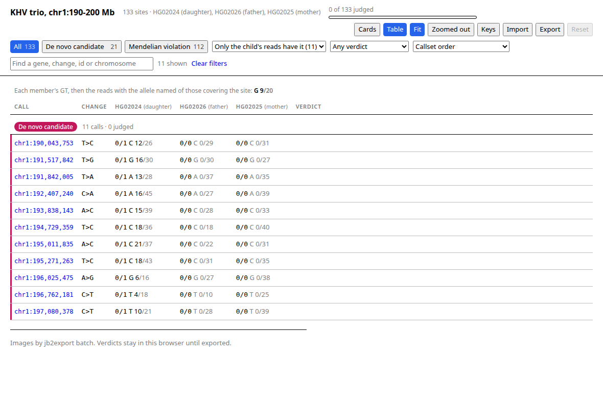

# Reviewing a trio

`variant-review-trio-sites` reads a trio VCF and its pedigree and keeps the
sites where the child's genotype cannot be made of one gamete from each parent.
A reviewer checks each site in the child's and both parents' reads, so the
portal draws all three in one picture per site.

```bash
# the sites the Mendelian check flags, de novo candidates and Mendelian
# violations, as a VCF jb2export can render
variant-review-trio-sites --vcf HG02024_VN049_KHVTrio.chr1.vcf.gz \
  --pedigree 20130606_g1k_3202_samples_ped_population.txt \
  --region 1:190000000-200000000 --out sites.vcf

# the calls, then the child's reads and the parents', in one image a site
jb2export batch --sites sites.vcf --config examples/khv_trio/config.json \
  --assembly hg38 --track ncbi_refseq_109_hg38_latest height:50 \
  --track khv_trio_calls height:70 \
  --track HG02024_cram heightMode:grow growMaxHeight=1000 \
  --track HG02026_cram heightMode:grow growMaxHeight=1000 \
  --track HG02025_cram heightMode:grow growMaxHeight=1000 \
  --flank 75 --outDir reads --manifest

# the same tracks 120 kb wide: each member's coverage on one 0-60 axis, and an
# arc for each pair or split read that does not fit the reference
WIDE=(pileup.show=false coverage.alleles.show=false
  coverage.interbase.show=false maxScore=60
  readConnections.show=true readConnections.ordinaryPairs.show=false height:130)
jb2export batch --sites sites.vcf --config examples/khv_trio/config.json \
  --assembly hg38 --track ncbi_refseq_109_hg38_latest height:60 \
  --track khv_trio_calls height:60 --track HG02024_cram "${WIDE[@]}" \
  --track HG02026_cram "${WIDE[@]}" --track HG02025_cram "${WIDE[@]}" \
  --flank 60000 --outDir wide --manifest

# name each alignments track by its sample, in track order
variant-review-portal --vcf sites.vcf \
  --pedigree 20130606_g1k_3202_samples_ped_population.txt \
  --images HG02024,HG02026,HG02025=reads --context wide --out portal
```

[`examples/khv_trio/config.json`](../examples/khv_trio/config.json) is the
config: the 1000 Genomes trio's phased chr1 calls with the pedigree, colored by
the `INFO/MERR` that `bcftools +mendelian2 -m a` writes, and each member's 30x
CRAM from the project's bucket, named by sample and relationship. The calls
track's relationship labels need a `jb2export` newer than 5.0.0-beta.22.

Each reads track grows to hold its whole pileup, up to 1000 px, so a 30x
member's every read is in the picture: a call the reads contradict shows in all
of them, not in the 20 a fixed height leaves room for. With no `height:` or
`heightMode:`, `jb2export batch` grows a track to 250 px and drops the reads
below, the variant reads sorted to the top; `height:200` fixes it at 200.

`--context` puts the wide run in a **Zoomed out** panel under each card's
picture, closed until clicked, opened on one card with `z` or on every card with
`Z` and the toolbar's Zoomed out. A site inside a deletion or duplication is one
of a run of errors there, and a member's coverage steps down or up across it,
which the 150 bp picture cannot show. A 30x pileup that wide is slow to stream
into a browser; the batch run streams it once, about 10 s a site for the three
CRAMs.

- **One axis**: `maxScore=60` draws the three members on one scale, so a member
  at half the others' depth looks it.
- **No allele colors**: reads from a paralog pile mismatches on every base and
  hide a dip under them.
- **Arcs for the pairs that do not fit**: a deletion with clean breakpoints
  draws red long-insert arcs across it in the members who carry it. The common
  LCE3B/LCE3C deletion, chr1:152,583,067-152,615,300, has eight such pairs in
  the daughter and none in the mother. A deletion between segmental
  duplications, as at CFHR1, draws none: its breakpoints sit in the repeat,
  where no read maps uniquely, and coverage is the evidence.


## Input

- **`--pedigree`** is the file JBrowse's `pedigreeLocation` reads: a PLINK
  `.fam` or `.ped` with no header (FID, IID, PAT, MAT, SEX, PHENO), or a table
  whose header names `SampleID` or `IID`, `FatherID` or `PAT`, `MotherID` or
  `MAT` and `Sex`, as 1000 Genomes'
  `20130606_g1k_3202_samples_ped_population.txt` does. The columns are found
  from the first row, never the extension. A line holding a tab is split on
  tabs, so an empty cell keeps its column. A parent or sex of `0`, `-9`, `NA`,
  `unknown` or an empty cell is missing, and sex `1` is male, `2` female and
  anything else `other`.
- **The trio** is the child among the VCF's samples whose father or mother is
  among them too. A VCF holding more than one takes `--child` to pick it. A
  child with one parent in the VCF is a duo, and one whose father and mother are
  the same sample is a selfed line.
- **`--transmission`** is a JSON list in the format of the assembly's
  `transmission` slot, `{ "refName", "sex", "from" }`, for the contigs a child
  does not inherit one copy from each parent: sex chromosomes, organelles,
  haplodiploid males. `refName` matches the VCF's `CHROM` exactly. Without it,
  every contig follows the autosomal rule, so a hemizygous male X call counts as
  a violation.
- **The alignments tracks** are one `jb2export batch` run, the child's track
  first. `--images` names each by its VCF sample, so the portal can match each
  read count to its sample. A track left out (a parent with no reads) leaves
  that member's read column empty.

## The classifier

`variant-review-trio-sites` and `variant-review-portal` both run
`lib/classifyTrio.mjs`, which handles any ploidy, read from each genotype, and
ignores phase. A duo whose known parent cannot settle a site is no call, and
`either`, polyploid and aneuploid splits never report a violation. The
classifier splits a flagged site into a de novo candidate, with an allele in
neither parent, or a Mendelian violation; the class orders the queue and sets
the verdicts a card offers.

JBrowse's trio tutorial colors the calls by the `INFO/MERR` that
`bcftools +mendelian2 -m a` writes, the number of trios in error, which puts de
novo candidates and other violations together. On the KHV trio over chr1:190-200
Mb, bcftools and the classifier flag the same 173 sites.

## The queue

`variant-review-trio-sites` writes the records whose class is in `--classes`,
`deNovoCandidate,mendelianViolation` by default, in the VCF's order and with its
header, so the file is still a VCF for `jb2export` and the portal. `consistent`
and `unsettled` (a no-call leaves the check open) are the other classes. The
portal orders the cards de novo candidates first, then Mendelian violations,
each in position order.

## A card

- **One image**: the calls track, then the child's, father's and mother's reads
  at the site, each track labeled with the sample and relationship its config
  names (`HG02024 (daughter)`).
- **The trio's calls**: each member's sample, relationship, `GT` and whatever
  else its `FORMAT` holds (`DP`, `AD`, `GQ`), beside the reads `jb2export`
  counted with the record's ALT out of the reads covering it.
- **The class and why**: the allele in neither parent for a de novo candidate
  (`G is in neither parent`), or the parent the child shares no allele with for
  a Mendelian violation (`nothing from the father's T/T`).
- **The verdicts that fit a trio**, keyed in order: real de novo, missed in the
  father, missed in the mother, child miscall, copy-number change (a deletion or
  uniparental disomy, where the calls are right for a one-copy sample), unclear.
  A duo offers the parent it has; a selfed line offers one parent.

[](https://jbrowse.org/demos/khv_trio_review/#card=66)

## Read support

The support filter splits the de novo candidates by the reads with the allele
that is in neither parent. The portal counts that allele at a substitution where
it is the ALT, or the REF at a site with one ALT (as the reads without the ALT):

- **no read in the child has the allele**: most likely a child miscall
- **a parent's reads have the allele too**: a parental allele the calls missed,
  or one stray read
- **only the child's reads have the allele**: the candidates that remain

The portal leaves indels uncounted, because an aligner often places an indel a
few bases from the record's column, outside the count. A Mendelian violation is
uncounted too, since none of its alleles is missing from both parents. The
reviewer judges each card from the picture, and the grouping only orders the
queue. Here the father is called `0|0`, yet 19 of his 36 reads have the
daughter's T:

[](https://jbrowse.org/demos/khv_trio_review/#card=21)

## The table and the TSV

The table has a section per class, with each member's `GT` and read count in a
column named by its sample. Export adds `trio_class` and `genotypes`
(`HG02024=0|1;HG02026=0|0;HG02025=0|0`) to the TSV, and Import reads the trio
verdicts back.

[](https://jbrowse.org/demos/khv_trio_review/#support=sample&view=table)

## The KHV trio

[jbrowse.org/demos/khv_trio_review](https://jbrowse.org/demos/khv_trio_review/)
is the run above: 91 de novo candidates and 82 Mendelian violations over
chr1:190-200 Mb, rendered with `--jobs 4` from the bucket in about a minute, and
its wide run in two and a half.

- **The Mendelian violations** are mostly the CFHR1 deletion: at 69 sites from
  196,807,156 to 196,835,670 the father is `1|1` on about half his depth and the
  daughter `0|0` on about half hers, a one-copy sample called homozygous. In the
  table they are 69 rows in a row, which a click on the first, a shift-click on
  the last and <kbd>5</kbd> answer as one
  ([Answering a run of cards at once](reviewing.md#answering-a-run-of-cards-at-once)).
- **The de novo candidates**, in a random sample of 30 checked by eye:
  - 8 a missed parental het: the child's allele in a parent's reads at the site
  - 6 an indel at the site in a parent's reads and the child's, which the caller
    wrote as a different allele
  - 11 a child miscall, the child's reads lacking the allele or homozygous where
    the call is het
  - 2 in the child's reads alone (chr1:193,838,143 and chr1:195,271,263)
  - 3 unclear, a parent with one read of the allele or a repeat

At the first of the CFHR1 sites, the father has 15 reads and the daughter 12, to
the mother's 23:

[](https://jbrowse.org/demos/khv_trio_review/#card=100)
