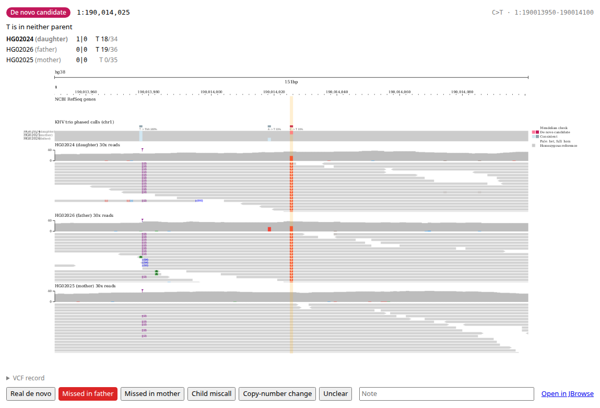

# Reviewing a trio

A trio VCF and a pedigree give a queue of the sites where the child's genotype
cannot be made of one gamete from each parent. JBrowse's Mendelian check flags
those sites; checking one means the child's and both parents' reads at it. The
portal draws the three in one picture a site, so the queue can be finished.

```bash
# the sites the Mendelian check flags, de novo candidates and Mendelian
# violations, as a VCF jb2export can render
variant-review-trio-sites --vcf HG02024_VN049_KHVTrio.chr1.vcf.gz \
  --pedigree 20130606_g1k_3202_samples_ped_population.txt \
  --region 1:190000000-200000000 --out sites.vcf

# the calls, then the child's reads and the parents', in one image a site
jb2export batch --sites sites.vcf --config examples/khv_trio/config.json \
  --assembly hg38 --track ncbi_refseq_109_hg38_latest height:50 \
  --track khv_trio_calls height:70 --track HG02024_cram height:200 \
  --track HG02026_cram height:200 --track HG02025_cram height:200 \
  --flank 75 --outDir reads --manifest

# name each alignments track by its sample, in track order
variant-review-portal --vcf sites.vcf \
  --pedigree 20130606_g1k_3202_samples_ped_population.txt \
  --images HG02024,HG02026,HG02025=reads --out portal
```

[`examples/khv_trio/config.json`](../examples/khv_trio/config.json) is the
config: the 1000 Genomes trio's phased chr1 calls with the pedigree, colored by
the Mendelian check, and each member's 30x CRAM from the project's bucket, named
by sample and relationship. The calls track's relationship labels and Mendelian
colors need a `jb2export` newer than 5.0.0-beta.22.

## Input

- **`--pedigree`** is the file JBrowse's `pedigreeLocation` reads: a PLINK
  `.fam` or `.ped` with no header (FID, IID, PAT, MAT, SEX, PHENO), or a table
  whose header names `SampleID` or `IID`, `FatherID` or `PAT`, `MotherID` or
  `MAT` and `Sex`, as 1000 Genomes'
  `20130606_g1k_3202_samples_ped_population.txt` does. The columns are found
  from the first row, never the extension. A parent of `0` is unknown, and sex
  `1` is male, `2` female, `0` or `-9` missing and anything else `other`.
- **The trio** is the child among the VCF's samples whose father or mother is
  among them too. A VCF holding more than one takes `--child` to pick it. A
  child with one parent in the VCF is a duo, and one whose father and mother are
  the same sample is a selfed line.
- **`--transmission`** is a JSON list in the shape of the assembly's
  `transmission` slot, `{ "refName", "sex", "from" }`, for the contigs a child
  does not inherit one copy from each parent: sex chromosomes, organelles,
  haplodiploid males. `refName` matches the VCF's `CHROM` exactly. Left out,
  every contig takes the autosomal rule, which reads a hemizygous male X call as
  a violation.
- **The alignments tracks** are one `jb2export batch` run, the child's track
  first. `--images` names each by its VCF sample, so the portal knows whose
  reads each count is. A track left out (a parent with no reads) leaves that
  member's read column empty.

## The classifier

Both commands run JBrowse's `classifyTrio` (ADR-279 in jbrowse-components), the
one rule the variant track colors by: any ploidy, read from the genotype; a duo
the known parent cannot settle is no call; `either`, polyploid and aneuploid
splits never report a violation. The check ignores phase.

`@jbrowse/plugin-variants` 5.0.0-beta.22, the latest published, predates the
check and exports no subpath for it, so `lib/vendor/classifyTrio.ts` is a copy,
byte for byte, with its truth-table tests in `test/vendor/`. It goes when a
published package exports the file (see [DEVELOPMENT.md](../DEVELOPMENT.md)).

## The queue

`variant-review-trio-sites` writes the records whose class is in `--classes`,
`deNovoCandidate,mendelianViolation` by default, in the VCF's order and with its
header, so the file is still a VCF for `jb2export` and the portal. `consistent`
and `unsettled` (a no-call leaves the check open) are the other classes. The
portal orders the cards de novo candidates first, then Mendelian violations,
each in position order.

## A card

- **One image**: the calls track, then the child's, father's and mother's reads
  at the site, each track named by its config, which writes sample and
  relationship (`HG02024 (daughter)`).
- **The trio's calls**: each member's sample, relationship, `GT` and whatever
  else its `FORMAT` holds (`DP`, `AD`, `GQ`), beside the reads `jb2export`
  counted with the record's ALT over the reads covering it.
- **The class and why**: the allele in neither parent for a de novo candidate
  (`G is in neither parent`), or the parent the child shares no allele with for
  a Mendelian violation (`nothing from the father's T/T`).
- **The verdicts that fit a trio**, keyed in order: real de novo, missed in the
  father, missed in the mother, child miscall, copy-number change (a deletion or
  uniparental disomy, where the calls are right for a one-copy sample), unclear.
  A duo offers the parent it has; a selfed line offers one parent.

[](https://jbrowse.org/demos/khv_trio_review/#card=66)

## The reads say

For a substitution whose allele in neither parent is its ALT, or the REF of a
site with one ALT (counted as the reads without the ALT), the support filter
sorts the de novo candidates three ways:

- **no read in the child has it**: a child miscall, most likely
- **a parent's reads have it too**: a parental allele the calls missed, or one
  stray read
- **only the child's reads have it**: the candidates left standing

An indel stays uncounted: an aligner often places it a few bases from the
record's column, where the count misses it. So does a Mendelian violation, which
has no allele in neither parent. The picture decides a card; the grouping orders
the queue. Here the father is called `0|0`, yet 19 of his 36 reads carry the
daughter's T:

[](https://jbrowse.org/demos/khv_trio_review/#card=21)

## The table and the TSV

The table is sectioned by class, with each member's `GT` and read count in a
column named by its sample. Export adds `trio_class` and `genotypes`
(`HG02024=0|1;HG02026=0|0;HG02025=0|0`) to the TSV, and Import reads the trio
verdicts back.

[](https://jbrowse.org/demos/khv_trio_review/#support=sample&view=table)

## The KHV trio

[jbrowse.org/demos/khv_trio_review](https://jbrowse.org/demos/khv_trio_review/)
is the run above: 91 de novo candidates and 82 Mendelian violations over
chr1:190-200 Mb, rendered with `--jobs 4` in about 30 seconds from the bucket.

- **The Mendelian violations** are mostly the CFHR1 deletion: at 69 sites from
  196,807,156 to 196,835,670 the father is `1|1` on about half his depth and the
  daughter `0|0` on about half hers, a one-copy sample called homozygous.
- **The de novo candidates**, a random sample of 30 read by eye:
  - 8 a missed parental het: the child's allele in a parent's reads at the site
  - 6 an indel at the site in a parent's reads and the child's, which the call
    writes as a different allele
  - 11 a child miscall, the child's reads lacking the allele or homozygous where
    the call is het
  - 2 in the child's reads alone (chr1:193,838,143 and chr1:195,271,263)
  - 3 unclear, a parent with one read of the allele or a repeat

The first of the CFHR1 sites, the father's 15 reads and the daughter's 12
against the mother's 23:

[](https://jbrowse.org/demos/khv_trio_review/#card=100)
